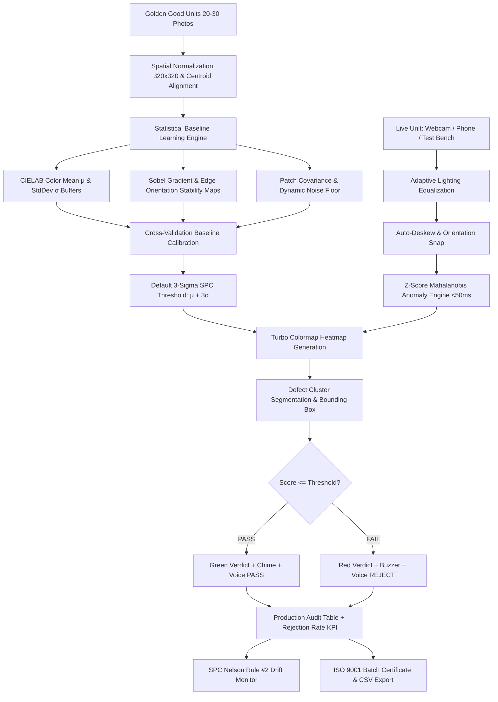

# SigmaLens: Few-Shot Industrial Visual Quality Control & Anomaly Inspection

> **Event:** Tech4Bharat 2026 | Global Accelerator Vision Summit (JanAI Mass Entrepreneurship Challenge)  
> **Organizers:** Karnataka Arya Vysya Mahasabha (KAVM) • JanAI • RV College of Engineering  
> **Track:** Theme 4: Manufacturing & Industry — Statement 4.2: Defect Inspection (Applied AI System)  
> **Team:** Team Strawhead — Abhijeet Dubey (CTO / Founder), Shiva Pandey (COO) & Keval Shinde (AI/ML & Edge Deployment Lead)  
> 💻 **Application Mode:** Standalone Edge Web Application / Offline Progressive Web App (`http://localhost:5173`)  
> 📄 **Technical Proof of Concept (POC) Report:** [Read POC Specification (POC.md)](./POC.md)  
> 📊 **Official Submission Deck (Executive Dark Slate Theme):** [`SigmaLens_Tech4Bharat_Dark_Submission.pptx`](./SigmaLens_Tech4Bharat_Dark_Submission.pptx)  
> 🎤 **Executive Pitch Script & Field Defence:** [Read PITCH_SCRIPT.md](./PITCH_SCRIPT.md)

---

## 1. Project Overview

Small and medium-sized manufacturers (MSMEs) face a critical bottleneck: high-end automated optical inspection (AOI) systems from vendors like Keyence or Cognex cost upwards of ₹20,00,000 ($25,000), while conventional supervised deep learning requires thousands of labeled defect photos that factories simply do not possess. Consequently, small manufacturers rely on manual human visual inspection, where eye fatigue leads to an 8–15% defect escape rate.

**SigmaLens** is an edge-based machine vision quality control platform designed to eliminate this bottleneck:
- **Zero Defect Dataset Needed:** Learns the statistical distribution of "normal" manufacturing tolerances from just **20–30 photos of standard good units** using unsupervised 3-Sigma Statistical Process Control (SPC).
- **Real-Time Live Camera Scoring:** Operates at **sub-50ms latency** on standard phone cameras or cheap $15 USB webcams.
- **Thermal Anomaly Heatmaps:** Overlays a perceptual **Turbo colormap** directly over defective regions and projects dynamic bounding boxes with spatial quadrant coordinates.
- **Supervisor Tunable Threshold:** Allows real-time tolerance adjustments with dynamic re-evaluation, audio chimes, and an instant 3-Sigma baseline calibration preset.
- **Shift Audit Logging & Analytics:** Tracks **Today's Rejection Rate %**, yield trends, and exports auditable CSV/JSON reports alongside **ISO 9001:2015 Conformance Certificates**.
- **100% Client-Side Edge Execution:** Runs entirely in the browser with zero cloud server costs, preserving industrial IP and operating offline.

---

## 2. Key Features

| Feature | Description |
| :--- | :--- |
| **Few-Shot "Normal" Learning** | Learns spatial color moments ($\mu, \sigma$), Sobel gradient stability, and patch variance from 20–30 golden units without defect labels. |
| **Real-Time Thermal Heatmap** | Generates a high-contrast Turbo colormap heatmap showing the exact location and intensity of deviations. |
| **Defect Localization & Callouts** | Connected-component analysis detects defect clusters and draws targeted bounding boxes with quadrant coordinates (e.g., `DEFECT Center-Left (88, 200)`). |
| **Tunable Supervisor Threshold** | Interactive slider with $\pm 1.0\%$ nudge controls and a 3-Sigma auto-calibration button for Statistical Process Control. |
| **Shift Logging & Today's Rejection Rate** | Live telemetry tracking Total Inspected, Passed, Rejections, Latency, and glowing Today's Rejection Rate %. |
| **Adaptive Lighting Invariance** | Real-time CIELAB luminance equalization normalizes ambient light shifts, shadows, and specular glare. |
| **Hands-Free Motion-Stillness Trigger** | Optical motion energy detection automatically triggers inspection when a worker places a unit and motion settles (<2.5%). |
| **SPC Process Drift Alert (Nelson Rule #2)** | Detects upward anomaly score trends across 4 consecutive units to warn of machine tooling wear before defect production. |
| **Auditable ISO 9001:2015 Certificate** | Computes batch $C_{pk}$ Process Capability Index with digital supervisor sign-offs and one-click printable PDF. |
| **Industrial Voice Announcer** | Text-to-Speech synthesis speaks Pass/Fail verdicts and defect locations aloud for hands-free sorting. |
| **Phone QR Connect Mode** | Generates a local network QR code allowing any smartphone to act as a wireless AOI scanner on local Wi-Fi. |
| **Interactive Anomaly Brush** | On-canvas brush tool allowing supervisors or judges to paint synthetic scratches, burns, or oil stains to test sensitivity. |
| **Automated Conveyor Line Simulation** | Live animated conveyor sorting parts at 15–60 PPM with optical beam triggers, camera hood strobe, pneumatic reject kicker (`pssht!` air sound), and dual Pass/Scrap hoppers. |
| **80/20 Defect Pareto Analysis** | Dynamic Pareto bar and cumulative curve chart isolating vital defect modes with Six Sigma DMAIC corrective remediation guides. |
| **Financial Scrap & Keyence ROI Calculator** | Quantifies annual scrap cost prevented in ₹/$, payback period vs ₹20 Lakh ($25,000) legacy AOI, and human fatigue escape reductions. |
| **Virtual PLC & Modbus TCP Bridge** | Simulated Allen-Bradley/Siemens I/O terminal rack, live 3-color Andon stack light, Modbus TCP holding registers, and MQTT JSON telemetry stream. |

---

## 3. Technology Stack

- **Frontend Core:** Vanilla HTML5, Modern CSS3 (High-Contrast Industrial Dark HUD Design System)
- **Computer Vision & Statistical Engine:** Client-Side JavaScript (Float32Array vectorization, Sobel Edge Kernels, CIELAB Moment Decomposition, Mahalanobis Distance, Turbo Colormap LUT, Spatial Central Moments for Auto-Deskew)
- **Audio Synthesizer:** Web Audio API (Multi-frequency Pass chime & dual-tone Reject buzzer)
- **Speech Synthesis:** Web Speech API (`SpeechSynthesisUtterance`)
- **Build Tool & Dev Server:** Vite 8.3
- **Data Persistence & Export:** HTML5 Canvas, Blob API, RFC 4180 CSV export, Structured JSON export, CSS Print Media Queries

---

## 4. Architecture & Workflow



---

## 5. Dataset & Pre-Loaded Industrial Recipes

SigmaLens includes **4 pre-loaded procedural industrial recipes** complete with 20–25 realistic golden baseline variations and verified defect suites:

1. **SMT Circuit Board (Rev-D):**
   - 24 Golden Units
   - Defects: Missing Capacitor (C12), Solder Bridge Short (U1 Pins 4-5), Blown Resistor, Copper Trace Scratch, Solder Flux Splatter.
2. **Machined Steel Gear Flange:**
   - 22 Golden Units
   - Defects: Chipped/Fractured Tooth, Axial Bore Gouge, Pitting Rust Dent, Oil Grease Stain, Machining Edge Burr.
3. **Pharma 10-Capsule Blister Pack:**
   - 25 Golden Units
   - Defects: Missing Capsule (Cavity #7 Empty), Crushed Capsule & Powder Leak, Torn Foil Seal, Discolored Pill.
4. **Beverage Bottle Cap & Tamper Seal:**
   - 20 Golden Units
   - Defects: Severed Tamper Ring, Skewed Cross-Thread, Crown Dent, Plastic Flashing.

*Additionally, users can upload custom photos or use 1-click camera burst capture to train custom product recipes in under 2 seconds.*

---

## 6. Setup & Installation Instructions

### Prerequisites
- Node.js (v18 or higher recommended)
- npm (v9 or higher)
- Modern web browser (Chrome, Edge, Firefox, Safari)

### Local & Edge Deployment
- Runs directly on edge hardware (laptops, industrial mini PCs, or Android devices) via local web server:
```bash
# 1. Clone the repository
git clone https://github.com/abhijeetdubey22/SigmaLens-AI.git
cd SigmaLens-AI

# 2. Install dependencies
npm install

# 3. Start development server
npm run dev

# 4. Open in browser: http://localhost:5173/
```

### Production Build
```bash
# Build optimized bundle
npm run build

# Preview production build locally
npm run preview
```

---

## 7. Screenshots & Demo Walkthrough

1. **Live Inspection Feed:** High-contrast HUD with reticle brackets, target crosshairs, live video canvas, and Turbo colormap overlay.
2. **Defect Bounding Box:** Automatic localization highlighting defect cluster coordinates (e.g. `DEFECT Center-Left (88, 200)`).
3. **Supervisor Threshold Control:** Real-time slider with statistical 3-Sigma reference track showing green safe zone, yellow warning margin, and red reject zone.
4. **Production Telemetry Banner:** Real-time telemetry displaying Today's Rejection Rate %, Total Inspected, Passes, Rejections, and Latency.
5. **Auditable ISO 9001 Certificate:** Modal displaying Certificate ID, Yield Rate %, $C_{pk}$ Process Capability Index, and QA Supervisor sign-off block.

---

## 8. Limitations & Future Scope

### Current Limitations
- Best performance achieved with a consistent inspection distance and fixture alignment (mitigated by our built-in Alignment Guide and Auto-Deskew).
- Camera resolution scaled to 320x320 for sub-50ms browser execution.

### Future Scope
- **Multi-Camera Synchronous Stereo Inspection:** Top and side views inspected in a single cycle.
- **Embedded Edge Deployment:** Direct deployment to Raspberry Pi 5 / NVIDIA Jetson Orin via WebAssembly / ONNX Runtime.
- **PLC Industrial Protocol Integration:** Direct Modbus TCP / MQTT triggers for physical robotic pneumatic reject arms on conveyor lines.

---

## 9. Team Details

- **Event:** TechForge 2026 Hackathon
- **Team Name:** Strawhead
- **Problem Statement:** Problem Statement 1: AI/ML — VisionQC (Industrial Visual Quality Inspection)
- **Developer & Presenter:**
  - **Abhijeet Dubey** (Solo)
